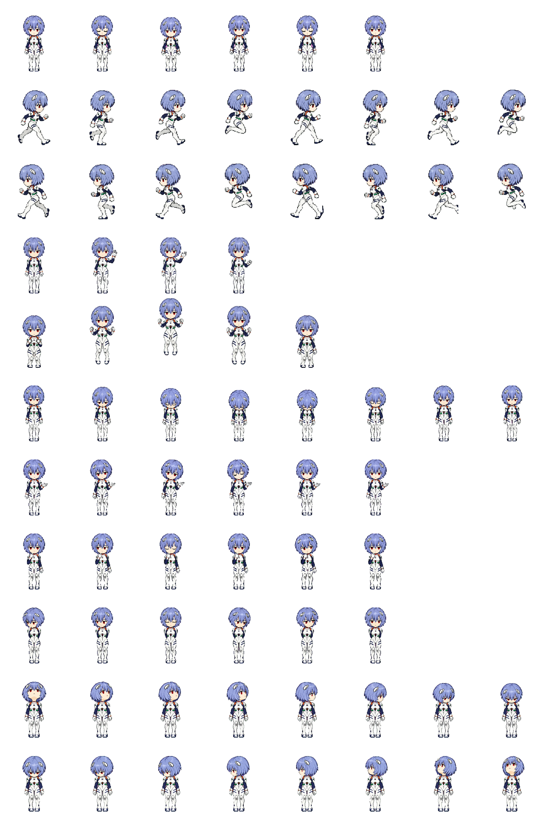

# Rei — Codex Pet

Rei Ayanami in a 32-bit pixel-art style. This is a custom Codex pet using the sprite atlas v2 format.



## Files

- `pet.json` — pet metadata and sprite format version.
- `spritesheet.png` — transparent PNG, 1536 × 2288 px.

## Install in Codex CLI

Pets are available in supported interactive terminals. Copy the `rei` pet files into your Codex user pets directory:

```bash
mkdir -p "$HOME/.codex/pets/rei"
curl -L "https://github.com/astahaha/rei-codex-pet/archive/refs/heads/main.zip" -o /tmp/rei-codex-pet.zip
unzip -o /tmp/rei-codex-pet.zip -d /tmp/rei-codex-pet
cp /tmp/rei-codex-pet/rei-codex-pet-main/pet.json "$HOME/.codex/pets/rei/pet.json"
cp /tmp/rei-codex-pet/rei-codex-pet-main/spritesheet.png "$HOME/.codex/pets/rei/spritesheet.png"
```

Restart Codex CLI, open an interactive session, and choose the pet with `/pets` or `/pet`.

## Compatibility

This repository contains a Codex sprite atlas v2 measuring 1536 × 2288. Uploading a custom pet to ChatGPT on the web uses a separate format: a transparent PNG or WebP measuring exactly 1536 × 1872 px. This file is not directly compatible with the ChatGPT web upload flow.

Pets are not available in the Codex IDE extension. Use Codex CLI or the ChatGPT desktop app for supported pet features. Availability depends on the app and terminal version. See the [official Pets documentation](https://learn.chatgpt.com/docs/pets).

## Copyright

Rei Ayanami is a character from Neon Genesis Evangelion. This is unofficial fan art. The character and source elements belong to their respective rights holders. This repository does not grant a license to those elements.
